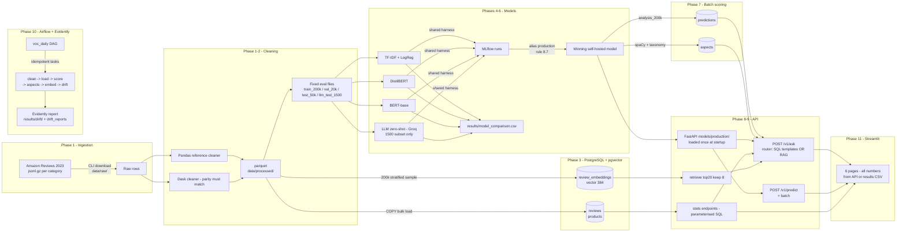

# flow.md — How the VoxLens machine works

Companion to `decision.md` (why) and `docs/PRD.md` (spec).
Read this first when returning to the project.

---

## 1. End-to-end data flow



Plain-language version:

1. **Ingest** raw category files into `data/raw/` (re-runnable, skips what exists).
2. **Clean** with Pandas (reference) and Dask (scale) → identical parquet in `data/processed/` → dedupe → deterministic hash split → four fixed evaluation files.
3. **Load** parquet into Postgres with COPY (products first, then reviews); embeddings into pgvector later.
4. **Train/compare** four sentiment models through one shared harness → MLflow runs → comparison table → production alias.
5. **Score** a 200k analysis sample with the production model → `predictions` + `aspects` tables (idempotent).
6. **Serve** via FastAPI (predict, stats, ask) with models loaded once at startup.
7. **Answer** questions via router: counts/trends → whitelisted SQL templates; everything else → pgvector retrieval + LLM generation with citations and abstention.
8. **Orchestrate** daily with Airflow; **monitor** drift with Evidently (reference vs current batch).
9. **Show** everything in Streamlit, which only talks to the API and to `results/` files — no hard-coded numbers.

---

## 2. Phase map (input → output → verify)

| Phase | Input | Output | You verify by |
|---|---|---|---|
| 0 Scaffolding | empty repo | folder tree, pinned pyproject, ruff/pytest, Postgres-only compose, Makefile, CI | `make setup && make lint && make test`; `docker compose ps` healthy; CI green |
| 1 Data | dataset card read, category choice | `data/raw/`, `data/processed/*.parquet`, 4 fixed eval files, `notebooks/eda.ipynb` | tests pass; row counts shrink per stage; no review id in two splits |
| 2 Scale | Phase 1 parquet | Dask cleaner, parity test, `results/benchmarks/processing.csv` | parity = exact match; CSV numbers plausible on re-run |
| 3 DB | Phase 1 parquet | migrations, COPY loader, 8 analytics queries | row counts equal parquet; each query run by hand once |
| 4 Harness + TF-IDF | eval files | `metrics/latency/cost.py`, dummy + TF-IDF in MLflow, first comparison rows | metric tests hand-computed; TF-IDF beats dummy; MLflow run visible |
| 5 Transformers | train_200k, val_20k | trained DistilBERT + BERT, `import_run.py`, harness rows | CUDA verified first; local smoke completes; latency measured locally |
| 6 LLM + table | llm_test_1500, Groq keys | `llm_zero_shot.py`, final comparison + charts, production alias | dry-run approved first; spend ≤ cap; registry shows alias |
| 7 Aspects | configs/aspects.yaml, your 100 labels | `aspects.py`, `analysis_200k`, batch score into Postgres | spot-check 20 sentences; double-run creates no dupes |
| 8 API | production model export | FastAPI service, tests, Dockerfile, load test | /docs works; empty string → 422; load-test p95 noted |
| 9 RAG | analysis_200k embeddings, your 60 questions | retrieve/router/answer, `/v1/ask`, `results/rag_eval.md` | 5 hand-asked questions cite real reviews; unanswerable → abstain |
| 10 Airflow + drift | incoming simulator | `voc_daily` DAG, Evidently drift module, 2-case test | DAG green in UI twice without dupes; normal=false, drifted=true |
| 11 Dashboard | API + results files | 6 Streamlit pages, dashboard service | click every page; stop API → friendly error |
| 12 Hardening | everything | README, `make smoke`, coverage, tag v1.0 | fresh clone follows only README; every README number traced to source |

---

## 3. Service topology (when Docker starts)

Containers are **staged** — one suspect per failure (PRD risk table: start Airflow only in Phase 10).

| Phase | Compose services running | Host venv runs |
|---|---|---|
| 0–3 | `postgres` (pgvector/pg16, healthcheck) | everything else |
| 4 | `postgres`, `mlflow` (persistent volume) | training scripts |
| 5–7 | `postgres`, `mlflow` | training, scoring |
| 8 | `postgres`, `mlflow`, `api` | tests, load test |
| 9 | + embeddings loaded into `postgres` | embed job |
| 10 | + `airflow` (webserver + scheduler, separate DB in Postgres) | simulator |
| 11 | + `dashboard` | — |
| 12 | `make up` starts the whole stack | `make smoke` runs e2e |

Batch jobs (clean, score, train, embed) are **never** containers-by-default: they run via `docker compose run` or directly in the virtual environment.

---

## 4. Request paths

### `POST /v1/predict` (and `/predict/batch`)
```
request id assigned → Pydantic validation (422 if invalid, text ≤ 5000 chars)
  → model from models/production/ (loaded ONCE at startup, never per request)
  → optional model override: tfidf | distilbert | bert
  → label + probabilities + aspects (from same span extraction)
  → write api_requests (endpoint, model, latency_ms, label, text_len)
  → structured JSON log with request id
```

### `POST /v1/ask`
```
question + optional filters
  → ROUTER:
      analytical keywords (how many | trend | increase | compare ...)
        → whitelisted, parameterised SQL templates ONLY
          (the LLM never writes SQL; generated SQL is never executed)
      everything else
        → embed question (all-MiniLM-L6-v2)
        → pgvector top 20 (filters: category/product/date/sentiment)
        → keep best 8 snippets
        → LLM answers ONLY from numbered snippets, cites review ids
        → insufficient evidence → abstained=true
  → answer, sources[], route (rag|sql), abstained, latency_ms
  → every LLM call honours MAX_LLM_SPEND_USD + disk cache
```

---

## 5. Fixed evaluation files (never regenerated differently)

| File | Size | Built in | Used by |
|---|---|---|---|
| `train_200k` | ≤200k stratified from train | Phase 1, seed 42 | all supervised training |
| `val_20k` | ≤20k from val | Phase 1 | tuning (C sweep, best-checkpoint) |
| `test_50k` | ≤50k from test | Phase 1 | final self-hosted evaluation |
| `llm_test_1500` | 1.5k stratified from test | Phase 1 | headline 4-model table (cost control) |

Split rule: `split = f(hash(review_id))` → 80/10/10, computed **after** dedupe, stored in a column, never recomputed.

---

## 6. Make targets (the reviewer's interface)

| Target | Does |
|---|---|
| `make setup` | Python 3.11 venv + pinned install (core first; ml group when needed) |
| `make lint` | ruff check + format --check |
| `make test` | pytest (unit; no GPU, no LLM, no Docker beyond Postgres) |
| `make up` | `docker compose up -d` (stage-appropriate services) |
| `make down` | `docker compose down` (keeps volumes) |
| `make smoke` | end-to-end on 1,000 reviews in <5 min, LLM mocked |

---

## 7. Golden rules while flowing through this repo

1. Numbers come only from commands run or files a script produced.
2. Library APIs come only from the installed version's docs/source.
3. One phase at a time; lint + tests before any "done".
4. Pipelines are idempotent — re-run never duplicates rows.
5. LLM paths: disk cache + `MAX_LLM_SPEND_USD` always.
6. Decisions → `decision.md`; flow changes → this file.
